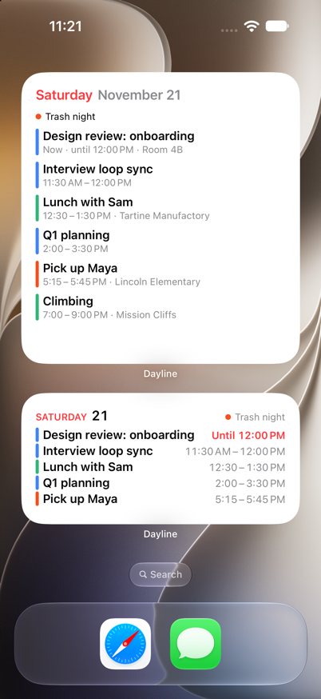

# Dayline

A personal iPhone calendar for Google Calendar, with home-screen and lock-screen widgets. Swift 6, SwiftUI and WidgetKit, with no third-party packages.

<p>
  
  
  
  
  
</p>

The screenshots use the built-in demo data.

## What it does

- Signs in with one or more Google accounts (Workspace or personal) and reads the next 14 days of events from the calendars you show. The agenda and widgets merge every account. A calendar shared with two of your accounts appears once, under the account you signed in to first.
- Settings lists each account with its calendars. You can add an account or sign out of one. If Google ends one account's session, its last events stay on screen and Settings offers Sign In Again. The other accounts keep working.
- Agenda grouped by day, with all-day and multi-day events, a now marker, Meet join buttons and your response to each invitation.
- Per-calendar show and hide, shared with the widgets.
- An Up Next widget in small, medium and large home-screen sizes and inline, rectangular and circular lock-screen sizes. Tapping an event opens it in the app.

Dayline only reads your calendar (`calendar.readonly`). Calendar data stays on the phone. Each account's Google refresh token is stored in the Keychain. There is no server.

## Layout

| Path | Contents |
| --- | --- |
| `Core/` | `DaylineCore`: the model, Google OAuth and Calendar request building and decoding, agenda grouping and widget timelines. Builds and tests on Linux and macOS. |
| `Sources/DaylineKit/` | Networking, Keychain, the shared snapshot store and preferences, used by the app and the widget. |
| `Sources/Dayline/` | The app. |
| `Sources/DaylineWidget/` | The widget extension. |
| `Support/` | Info.plist and entitlement files. |

## Build and test

Dayline builds with [xtool](https://github.com/xtool-org/xtool) on Linux or macOS.

```sh
swift test --package-path Core
xtool dev build --triple arm64-apple-ios-simulator
```

`scripts/sim` builds locally and runs the app in an iOS simulator on a Mac over SSH. Set `DAYLINE_SIM_HOST` to the Mac's SSH host, or to an empty string to use the simulator on this machine.

```sh
scripts/sim run -demo
scripts/sim screenshot agenda.png
```

The `-demo` launch argument signs in to sample data instead of Google.

## Install on an iPhone

### TestFlight

Every push to `main`, and a scheduled run on the 1st and 15th of each month, builds Dayline, signs it for the App Store and uploads it to TestFlight. The TestFlight app on the phone installs each build as it arrives. A TestFlight build stops opening 90 days after upload, and the scheduled runs keep a fresh one there. GitHub turns off scheduled workflows in a public repository after 60 days without activity, so check the Actions tab if the repository goes quiet.

One-time setup, with an App Store Connect team API key (App Manager role) in `ASC_KEY_ID`, `ASC_ISSUER_ID` and `ASC_KEY_PATH`:

1. `scripts/appstore ids` registers the App IDs `com.scowalt.dayline` and `com.scowalt.dayline.widget` with App Groups turned on.
2. In the developer portal, configure App Groups on both App IDs to include `group.com.scowalt.dayline`. The API can't do this.
3. In App Store Connect, create the app with bundle ID `com.scowalt.dayline`, and add yourself to an internal testing group.
4. `scripts/appstore signing` creates an Apple Distribution certificate and the App Store profiles in `~/.config/dayline/signing`.
5. `scripts/appstore secrets` stores the key, certificate and profiles in the `testflight` environment, which only `main` can use.

The certificate expires after a year. `scripts/appstore renew` repeats steps 4 and 5 when the certificate is within 30 days of expiring or a profile has changed, and prints nothing otherwise. A monthly bb automation on the build machine runs it from `origin/main`.

### xtool

Each `vX.Y.Z` tag publishes an unsigned `Dayline.ipa` on the [releases page](https://github.com/scowalt/dayline/releases). Sign it and install it over USB or Wi-Fi with xtool:

```sh
xtool auth login
xtool install Dayline.ipa
```

With a free Apple ID, the install expires after 7 days. Run `xtool install` again to renew it.

With a paid Apple Developer Program membership, log in with an App Store Connect API key (App Manager role) and the install lasts a year. The API can't assign app groups, so do that once in the developer portal before the first install:

1. Register the App Group `group.com.scowalt.dayline`.
2. Run `xtool install` once. It fails, but it registers the App IDs `XTL-<prefix>.com.scowalt.dayline` and `XTL-<prefix>.com.scowalt.dayline.widget`.
3. Turn on App Groups for both App IDs and select `group.com.scowalt.dayline`.
4. Run `xtool install` again.

## Google sign-in

Dayline uses the OAuth 2.0 authorization code flow with PKCE for an iOS OAuth client, with no client secret. The client ID in `Sources/DaylineKit/GoogleClient+Dayline.swift` is public by design. A fork needs its own client: create an iOS OAuth client for its bundle ID in Google Cloud, enable the Google Calendar API, and replace the ID.
